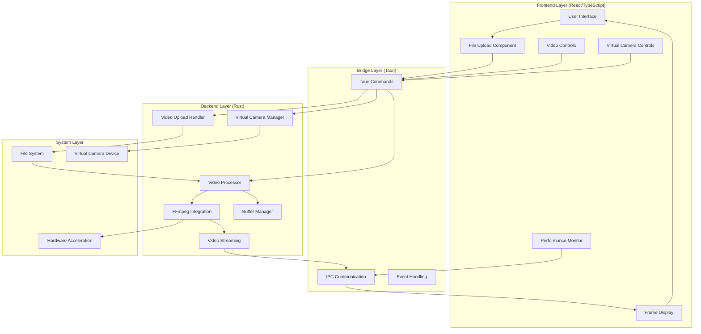
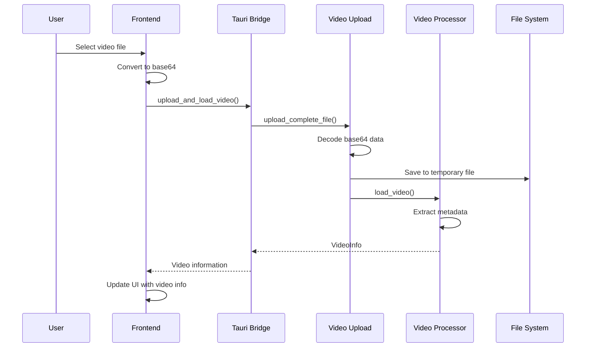
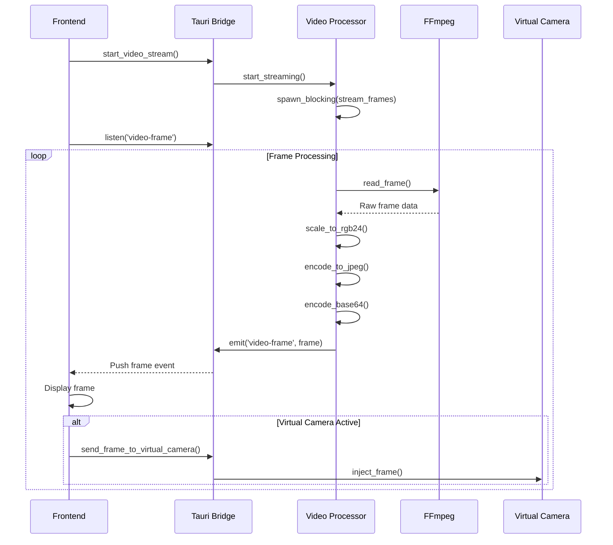

# CamLooper Architecture Documentation

## Table of Contents
- [Overview](#overview)
- [System Architecture](#system-architecture)
- [Technology Stack](#technology-stack)
- [Core Components](#core-components)
- [Data Flow](#data-flow)
- [Video Processing Pipeline](#video-processing-pipeline)
- [Performance Optimizations](#performance-optimizations)
- [Threading Model](#threading-model)
- [Error Handling](#error-handling)
- [Security Considerations](#security-considerations)

## Overview

CamLooper is built using a modern, cross-platform architecture that combines the performance of native Rust backends with the flexibility of web-based frontends. The application uses Tauri as the bridge between a React/TypeScript frontend and a high-performance Rust backend for video processing.

## System Architecture



## Technology Stack

### Frontend Technologies
- **React 18**: Modern UI framework with hooks and concurrent features
- **TypeScript**: Type-safe JavaScript for better development experience
- **Tailwind CSS**: Utility-first CSS framework for responsive design
- **shadcn/ui**: Modern component library built on Radix UI
- **Vite**: Fast build tool and development server

### Backend Technologies
- **Rust**: High-performance systems programming language
- **Tauri**: Cross-platform desktop app framework
- **FFmpeg**: Industry-standard video processing library
- **Tokio**: Asynchronous runtime for Rust
- **Serde**: Serialization/deserialization framework

### Platform-Specific Components
- **Windows**: DirectShow and MediaFoundation APIs
- **macOS**: Core Foundation and Core Graphics
- **Linux**: V4L2 (Video4Linux2) for virtual camera support

## Core Components

### Frontend Components

#### Main Application (`App.tsx`)
The primary React component that orchestrates the entire user interface and manages application state.

**Key Responsibilities:**
- State management for video playback, virtual camera, and UI
- Event handling for user interactions
- Real-time frame rendering and display
- Performance metrics monitoring

**State Management:**
```typescript
interface AppState {
  isPlaying: boolean;
  isVirtualCamActive: boolean;
  selectedVideo: File | null;
  videoInfo: VideoInfo | null;
  currentFrame: VideoFrame | null;
  streamStatus: StreamStatus;
  performanceMetrics: PerformanceMetrics;
}
```

#### Frame Buffer (`FrontendFrameBuffer`)
Client-side buffering system for smooth video playback.

**Features:**
- Configurable buffer size (default: 10 frames)
- Thread-safe frame management
- Automatic buffer health monitoring
- Frame dropping for performance optimization

### Backend Components

#### Video Processor (`video_processor.rs`)
Core component responsible for video processing and frame streaming.

**Key Features:**
- FFmpeg integration for video decoding
- Real-time frame processing and encoding
- Performance-optimized scaling and format conversion
- Automatic loop management
- Push-based frame delivery

**Core Structure:**
```rust
pub struct VideoProcessor {
    video_info: Option<VideoInfo>,
    video_path: Option<PathBuf>,
    stream_status: Arc<Mutex<StreamStatus>>,
    frame_sender: Option<mpsc::UnboundedSender<VideoFrame>>,
    is_streaming: Arc<Mutex<bool>>,
    loop_settings: Arc<Mutex<(u32, bool)>>,
    app_handle: Option<AppHandle>,
}
```

#### Video Upload Handler (`video_upload.rs`)
Manages file uploads with support for both streaming and complete file uploads.

**Upload Methods:**
- **Streaming Upload**: Chunked upload for large files
- **Complete Upload**: Base64-encoded single transfer
- **Session Management**: Temporary file handling and cleanup

#### Virtual Camera Manager (`virtual_camera.rs`)
Platform-specific virtual camera implementation with automatic frame resizing.

**Capabilities:**
- Cross-platform virtual camera creation
- Frame injection into virtual camera devices
- Camera configuration and status management
- Device enumeration and selection
- Automatic frame resizing with bilinear interpolation
- High-quality scaling for consistent output resolution
- Platform-optimized frame processing (Windows DirectShow, Linux V4L2, macOS AVFoundation)

#### Phone Remote (`remote/`)

Lets the companion mobile app ("CamLooper Remote") push a Zoom / Teams / Meet link to this
computer through the relay at `api.camlooper.com` (a Cloudflare Worker that lives in the
private camlooper.com workspace repo, not in this codebase).

- **Network-silent by default.** `remote/client.rs` builds no HTTP client and opens no socket
  until the user types the 6-digit code shown by the phone (`remote_link`). That claim is the
  app's first network call. Unlinking (from either side) deletes `<app_data_dir>/remote.json`,
  disables start-at-login and parks the task again.
- **One actor task** (`run_task`) owns the WebSocket (`tokio-tungstenite` + rustls/ring — pure
  Rust so the cargo-xwin Windows cross-build works), reconnecting with jittered exponential
  backoff (1 s → 60 s), a 30 s `{"type":"ping"}` keepalive and a 90 s read-idle timeout.
- **Commands:** `remote_get_state`, `remote_link`, `remote_unlink`, `remote_take_pending_command`,
  `remote_ack_command`, `remote_set_autostart`, `remote_get_autostart`. **Events to the webview:**
  `remote://status`, `remote://open-meeting`, `remote://linked`, `remote://unlinked-by-phone`,
  `remote://command-rejected`, `remote://show-linking`.
- **Startup race.** The server flushes a queued command as soon as the socket connects, often
  before React has registered listeners. Rust keeps it as `pending` until the frontend acks, and
  `use-remote.ts` calls `remote_take_pending_command` on mount. Duplicates are dropped by
  `commandId`; commands whose `createdAt` is older than 10 minutes are acked and ignored.
- **Allow-list** (`remote/meeting_url.rs`): https only, printable ASCII, no userinfo/port, hosts
  `zoom.us` / `*.zoom.us`, `teams.microsoft.com`, `teams.live.com`, `meet.google.com`. The server
  validates first; this is defence in depth. Shared vectors: `tests/fixtures/meeting-url-vectors.json`
  (a copy of the server's canonical file — keep them identical).
- **Dev:** `CAMLOOPER_API_URL=http://127.0.0.1:8787` targets a local relay (`wrangler dev`); debug
  builds also honour `CAMLOOPER_REMOTE_LINK_CODE=123456` to link without touching the UI.

#### Phone camera stream (`remote/stream/`, remote v2)

The phone streams its camera peer-to-peer over WebRTC and the app turns it into the virtual
camera. Signaling rides the same relay socket (opened with `?protocol=2`); the app-level
protocol is in [remote-protocol.md](remote-protocol.md).

- **Receiver:** str0m 0.26 (sans-IO) with the vendored crypto provider
  `src-tauri/vendor/str0m-purecrypto` (RustCrypto, plus `ring` for the certificate; str0m's own
  `rust-crypto` feature pulls aws-lc-sys, which breaks the cargo-xwin build). One tokio task per
  session owns the `Rtc` and one UDP socket per usable IPv4 interface (at most 4, no VPN/tunnel
  or bridge interfaces); candidates go in the answer, the phone trickles. The sockets are open
  to the LAN: datagrams that are not this session's are dropped and never end it, remote
  candidates are filtered and capped at 32, and the phone closing the connection is a normal
  stop (`peer_stopped`), not an error.
- **Pipeline:** depacketized H.264 → Annex-B (SPS/PPS before every IDR) or VP8 → IVF on ffmpeg's
  stdin (`pipeline::Source::EncodedStdin`), then the existing `build_outputs` sinks: v4l2 on
  Linux, BGR24 → softcam on Windows, BGRA → CMIO on macOS, letterboxed to the camera geometry at
  a constant frame rate.
- **Handoff:** while a phone session holds the camera, the video loop is paused and refuses to
  start, and so do the in-app camera preview and recording; the loop is resumed when the stream
  ends. The session task runs under `catch_unwind` and the acquire in its own never-cancelled
  task, so the camera is handed back exactly once whatever happens — a panic, a stop in the
  middle of a polkit/UAC prompt. (`catch_unwind` needs an unwinding build. The release
  profile deliberately does not set `panic = "abort"` — see the note in `Cargo.toml`; if it
  ever does, a panic ends the process and the claim with it, and the panic tests describe
  dev builds only.) When a session ends during the handoff the acquire is told
  (`runner::Cancel`): on Linux the pending `pkexec` is killed, which closes the polkit
  prompt; a Windows UAC prompt cannot be closed from outside and is waited for.
- **Epochs:** every started session task gets a local, never-repeating epoch from the state
  machine. Session events are matched by it (not by the phone-chosen `sessionId`, which a
  phone may reuse), and the camera is acquired and released under it: `release(epoch)` does
  nothing unless that epoch holds the claim, so a session that was given up on, or whose
  acquire was refused, can never stop the camera under a later one.
- **Rules:** `machine.rs` is a pure state machine (one session, 60 s decision timeout, 15 s
  quiet period after an explicit decline, at most 5 prompts a minute, busy, stale sessions,
  10 s grace when the phone leaves the relay mid-stream, stop watchdog); `manager.rs` runs
  it. The stop watchdog is 10 s, or 125 s for a session that was still preparing the camera.
  When it fires — or the user forces a hung stop after 5 s — the status becomes `error`
  rather than `idle`, and requests keep being answered `busy` until that session's `Closed`
  arrives: until then it still holds the camera, and a second session next to it would mean
  two writers. There is no auto-accept in the app: a `DecisionSink`
  (the UI) must call `remote_stream_accept`.
- **Relay frames and pairings:** outbound frames reach the socket through queues, so one made
  for the previous pairing can surface after a relink. `signal::PairScope` in the relay task
  only lets a frame out if its `sessionId` was heard from the phone of the socket's current
  pairing; a frame whose send failed stays first in line for the next socket.
- **Commands / events:** `remote_stream_status`, `remote_stream_accept`, `remote_stream_reject`,
  `remote_stream_stop`; `remote://stream-status` is the UI's single source of truth (it
  carries a growing `seq`, and `sessionId`/`deviceName`/`expiresAt` while a request is
  pending — the confirm dialog is derived from it and keyed by `sessionId` + `expiresAt`,
  since a phone may reuse an id; `releasing` is set while a given-up session still holds the
  camera, which the UI treats as busy although `state` is `error`). `remote://stream-request` and
  `remote://stream-request-dismissed` are informational only.
- **Consent guards:** a request raises the window without taking keyboard focus; the dialog
  never focuses Accept and keeps it disabled ~1.2 s after it becomes visible/focused;
  `remote_stream_accept` refuses other windows and anything under 800 ms after the request.
- **Dev:** `cargo run --example phone_stream_cli -- --code 123456 --null` runs the whole path
  headless; `cargo test --test phone_stream_loopback` runs it against a simulated phone.
  The CLI also takes a phone's "Loop a video": the file is received by `file_receive` and
  looped by the app's own engine through `loop_engine::EngineLoop` — the same `LoopPlayer`
  the app installs, with a different `LoopHost` (which camera, who is told).
- **Not done yet:** the offer is not authenticated end to end — a compromised relay could
  inject video after the user accepts. See "Known limitation / later" in
  [remote-protocol.md](remote-protocol.md) for the proposed design.

#### Auto-join (`meeting/`)

When a meeting link arrives and "Join meetings automatically" is on, `meeting_open` launches a
Chromium browser that CamLooper controls instead of handing the URL to the default browser.

- **Browser discovery** (`meeting/browser.rs`): Chrome → Edge → Brave → Chromium, by well-known
  paths on Windows/macOS and `PATH` on Linux. None found → `mode: "unavailable"` and the frontend
  falls back to the opener plugin.
- **Dedicated profile** `<app_data_dir>/meeting-browser`, launched with `--remote-debugging-port=0`
  (the port lands in `DevToolsActivePort`), `--use-fake-ui-for-media-stream` (camera/mic prompts
  are accepted by the browser itself) and `--new-window <url>`. A second launch hands the URL to
  the running instance. Chrome ≥ 136 refuses remote debugging on the default profile, so the
  separate profile is mandatory; it also keeps the user's Google / Microsoft / Zoom sign-ins
  apart from their normal browser ("Open meeting browser" exists for that one-time sign-in).
- **DevTools client** (`meeting/cdp.rs`): `GET /json/list` on 127.0.0.1 to pick the newest page
  whose host matches the provider, then `Runtime.evaluate` over its WebSocket. Loopback only;
  nothing here talks to api.camlooper.com.
- **Join scripts** (`meeting/scripts/*.js`, embedded with `include_str!`): one per provider,
  idempotent, evaluated once a second for up to 3 minutes; each returns `{status}` out of
  `waiting`, `clicked_allow`, `clicked_web`, `clicked_join`, `waiting_admission`, `joined`,
  `blocked`. Teams uses its `data-tid` hooks, Meet its `jsname` attributes with multilingual text
  fallbacks, Zoom the web client (`/j/<id>` links are rewritten to `app.zoom.us/wc/<id>/join`).
  On timeout `dump.js` logs the visible controls so a renamed selector can be fixed from a
  user's Debug log.
- **Commands:** `meeting_browser_info`, `meeting_open`, `meeting_open_profile`. **Event:**
  `meeting://status` (`launching` → `joining` → optional `waiting_admission` → `joined` |
  `blocked` | `timeout` | `failed`). The two preferences (switch, guest display name) live in the
  webview's localStorage.

#### Tray & lifecycle (`tray.rs`)

An always-present tray icon (Show CamLooper / Link phone… / Start at login / Quit, labels pushed
from the frontend in the UI language). While a phone is linked, closing the window hides to the
tray so the phone can still reach the computer; unlinked, close quits as before.
`tauri-plugin-single-instance` focuses the running instance on a second launch.
`tauri-plugin-autostart` registers `camlooper --hidden` at login once a phone is linked; the
window is created with `visible: false` and `tray::init` shows it unless `--hidden` was passed
(and a phone is linked). The frontend gates the welcome popup and the ad banner on
`app://shown` / `get_startup_mode`, so a hidden login launch neither opens a browser nor counts
as an app open in analytics.

## Data Flow

### Video Upload Flow



### Video Streaming Flow



## Video Processing Pipeline

### Frame Processing Steps

1. **Video Decoding**
   ```rust
   // Open video file with FFmpeg
   let input = ffmpeg::format::input(&file_path)?;
   let video_stream = input.streams().best(ffmpeg::media::Type::Video)?;
   let mut decoder = codec_context.decoder().video()?;
   ```

2. **Frame Scaling**
   ```rust
   // Create scaler for RGB24 conversion
   let mut scaler = ffmpeg::software::scaling::context::Context::get(
       decoder.format(), decoder.width(), decoder.height(),
       ffmpeg::format::Pixel::RGB24, decoder.width(), decoder.height(),
       ffmpeg::software::scaling::Flags::FAST_BILINEAR,
   )?;
   ```

3. **Frame Encoding**
   ```rust
   // Convert frame to JPEG
   let mut encoder = JpegEncoder::new_with_quality(&mut cursor, 65);
   encoder.encode_image(&img)?;
   
   // Encode to base64 for transport
   let encoded = base64::prelude::BASE64_STANDARD.encode(&jpeg_data);
   ```

### Performance Characteristics
- **Frame Rate**: Capped at 30 FPS maximum
- **JPEG Quality**: Set to 65 for optimal size/quality balance
- **Pixel Format**: RGB24 for reduced memory usage
- **Scaling Algorithm**: Fast bilinear for performance

## Performance Optimizations

### Backend Optimizations

1. **Efficient Pixel Formats**
   - Uses RGB24 instead of RGBA (25% memory reduction)
   - Fast bilinear scaling algorithm
   - Hardware acceleration when available

2. **Adaptive Quality Control**
   - Dynamic JPEG quality adjustment based on performance
   - Frame dropping during high load
   - Intelligent buffer management

3. **Memory Management**
   - Frame buffer reuse
   - Automatic temporary file cleanup
   - Efficient base64 encoding

### Frontend Optimizations

1. **Push-Based Architecture**
   - Eliminates polling overhead
   - Real-time frame delivery
   - Event-driven updates

2. **Selective Rendering**
   - Conditional virtual camera forwarding
   - Performance metrics on demand
   - Optimized React rendering

3. **Buffer Management**
   - Configurable frame buffering
   - Automatic buffer health monitoring
   - Frame interpolation for smooth playback

## Threading Model

### Backend Threading Architecture

```rust
// Main thread: Tauri commands and UI communication
async fn start_video_stream() -> Result<(), String>

// Blocking thread: Video processing
tokio::task::spawn_blocking(move || {
    stream_video_frames_blocking(processor, app_handle)
})

// Channel communication: Frame distribution
let (frame_sender, frame_receiver) = mpsc::unbounded_channel();
```

### Thread Safety
- **Mutex Guards**: Protect shared state with `Arc<Mutex<T>>`
- **Blocking Operations**: Use `blocking_lock()` in video processing thread
- **Send/Sync Traits**: All shared types implement required traits
- **Channel Communication**: Unbounded MPSC channels for frame distribution

## Error Handling

### Comprehensive Error Management

```rust
// Custom error types
use anyhow::{anyhow, Result};

// Error propagation
pub async fn load_video(&mut self, file_path: PathBuf) -> Result<VideoInfo> {
    let input = ffmpeg::format::input(&file_path)
        .map_err(|e| anyhow!("Failed to open video file: {}", e))?;
    // ... processing
}
```

### Error Categories
- **File System Errors**: Invalid paths, permissions, disk space
- **Video Processing Errors**: Codec issues, format incompatibility
- **Virtual Camera Errors**: Device conflicts, driver issues
- **Performance Errors**: Memory exhaustion, frame dropping

## Security Considerations

### Data Privacy
- **Local Processing**: All video processing happens on the user's device
- **No Network Transfer**: Videos never leave the local system. The optional phone remote exchanges only pairing metadata and meeting URLs over TLS, and only after the user links a phone (see Phone Remote above)
- **Temporary File Security**: Secure temporary file handling with automatic cleanup
- **Memory Protection**: Sensitive data cleared from memory after use

### System Security
- **Sandboxed Environment**: Tauri provides security isolation
- **Permission Model**: Minimal required system permissions
- **File System Access**: Restricted to user-selected files
- **Virtual Camera Isolation**: Camera streams confined to local system

### Input Validation
- **File Type Validation**: Strict video format checking
- **Size Limits**: Reasonable file size restrictions
- **Content Sanitization**: Safe handling of user-provided data
- **API Parameter Validation**: All Tauri commands validate inputs

---

This architecture enables CamLooper to deliver high-performance video processing while maintaining security, privacy, and cross-platform compatibility. The modular design allows for easy maintenance and feature additions while ensuring optimal performance for real-time video streaming. 